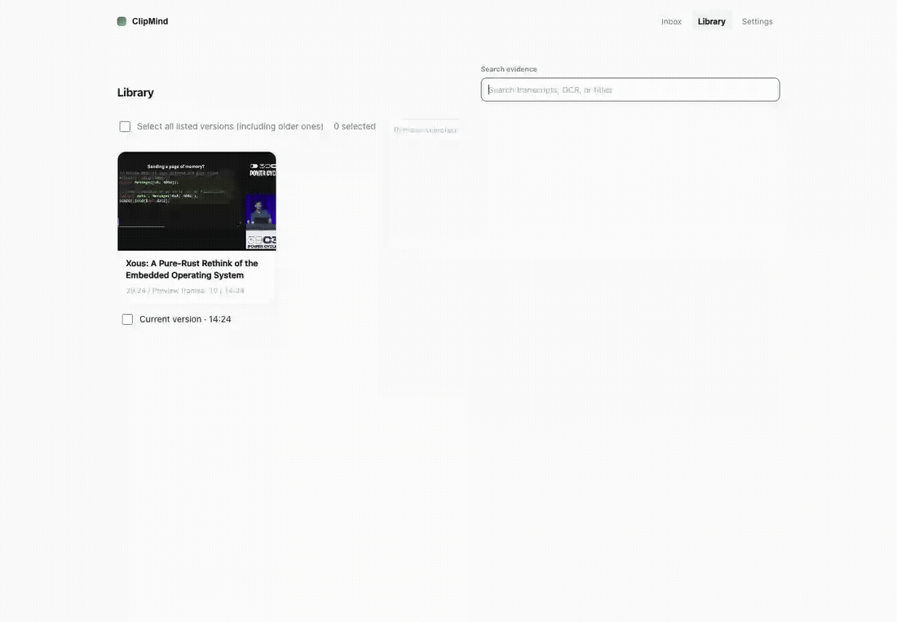

# ClipMind


[](https://github.com/yy31104/clipmind/actions/workflows/tests.yml?query=branch%3Amain)

A transcript misses the code, charts, and documents shown on screen.

ClipMind turns YouTube and Douyin links or local media into timestamped transcripts, screen text, and frames. It keeps the extracted evidence in a local folder that you can browse, search, or pass to another tool through the CLI, REST API, Python SDK, or MCP server.

Personal project. Built with AI assistance.

[Run locally](#run-locally) · [Measured quality](docs/SCREEN_QUALITY.md) · [Agent demo](docs/REAL_TALK_DEMO.md#a-real-agent-used-the-mcp-tools) · [Docs](#docs)

The v1.4.0 holdout used three complete public talks (40 minutes), including Mandarin, with one run per backend:

| Backend | Change recall | Boundary precision | Code character error rate |
| --- | ---: | ---: | ---: |
| Mac: MLX + Vision | 73/78 (93.59%) | 20.39% | 19.00% |
| Docker CPU: faster-whisper + Tesseract | 73/78 (93.59%) | 20.28% | 16.08% |

Recall meets the 85% target. Precision misses 50%; code error rates miss 15%.
AI-assisted annotations; human review pending. Source inspection found timing
and transcription discrepancies; original frozen scores remain unchanged.
Code scores cover 15 ROIs from one English talk. The Mandarin recording has change labels, with code OCR N/A.
[Results, regressions, raw records and review downloads](docs/SCREEN_QUALITY.md).



Search **“a string that is moved”** → speech at **12:01** → its ownership slide.
This recording uses a complete public 39-minute talk, not a generated fixture.
An agent also answered a question using the saved transcript, timeline and images
through MCP. [Source, attribution, captured calls and reproduction](docs/REAL_TALK_DEMO.md).

On the ten development excerpts, capture improved from 44/60 to 59/60 changes;
code CER improved from 39.29% to 6.24% on Mac and 54.30% to 23.61% on Docker.
These gains did not fully generalize to the holdout. `complete` means the
pipeline finished, not perfect recall. [Saved-frame comparison](https://github.com/yy31104/clipmind/releases/download/v1.4.0/clipmind-v1.4.0-screen-retention.gif).

## How it works

1. [sources/registry.py](clipmind/sources/registry.py) selects a source adapter; [acquisition.py](clipmind/acquisition.py) acquires media in a temporary directory.
2. [preflight.py](clipmind/preflight.py) estimates the work before [pipeline.py](clipmind/pipeline.py) starts speech and visual processing.
3. [asr.py](clipmind/asr.py), [ocr.py](clipmind/ocr.py), and [visual_states.py](clipmind/visual_states.py) extract timestamped speech, text, and visual changes.
4. [evidence.py](clipmind/evidence.py) writes the pack and its completion manifest; [index.py](clipmind/index.py) builds a searchable SQLite index.
5. [server.py](clipmind/server.py), [cli.py](clipmind/cli.py), [sdk.py](clipmind/sdk.py), and [mcp.py](clipmind/mcp.py) expose the saved evidence.

The full frame set is retained separately from the smaller reading preview. The completion manifest is written last; interrupted jobs remain visible after restart.

## Project layout

| Path | What | Start here |
| --- | --- | --- |
| `clipmind/` | Acquisition, extraction, storage, and interfaces | [pipeline.py](clipmind/pipeline.py) |
| `clipmind/web/` | Browser interface | [app.js](clipmind/web/app.js) |
| `schemas/` | Evidence Pack format | [JSON Schema](schemas/evidence-pack-v1.schema.json) |
| `tests/` | Offline lifecycle, API, and extraction checks | [test_pipeline.py](tests/test_pipeline.py) |
| `scripts/` | Installation, local samples, and measurement tools | [evaluate_silent_slides.py](scripts/evaluate_silent_slides.py) |
| `docs/` | Installation, usage, architecture, and privacy | [Usage](docs/USAGE.md) |

## Run locally

With Docker installed, one command starts the app with FFmpeg, Tesseract and
portable speech recognition included:

```bash
docker run --rm -p 127.0.0.1:8420:8420 -v clipmind-data:/data ghcr.io/yy31104/clipmind:v1.4.0
```

Open [127.0.0.1:8420](http://127.0.0.1:8420), paste a link or upload a local
video, then search its saved evidence in Library. No ClipMind account or paid
API key is required. Speech models download on first use. Docker uses the CPU;
its image does not include Chrome for Douyin's browser fallback.

For native Apple Silicon acceleration, or an existing Python setup, install
[uv](https://docs.astral.sh/uv/), Git and FFmpeg first (Linux/Windows also need
Tesseract), then run:

```bash
uv tool install --python 3.12 git+https://github.com/yy31104/clipmind.git@v1.4.0
```

Start with `clipmind doctor`, then `clipmind serve`. Speech language is detected
automatically. Set `CLIPMIND_ASR_LANGUAGE=en` (or another language code) to override it.
The PyPI package called `clipmind` belongs to another project; use the GitHub
command above. [Platform setup, updates and Docker persistence](docs/INSTALL.md).

Temporary source media is cleaned after processing; saved screenshots,
transcripts and model weights remain. Removing packs in the UI moves them to
`.trash`, which still occupies disk space. The Docker named volume persists
across restarts. Review [privacy](docs/PRIVACY.md) before using browser cookies.

## Develop and reproduce

```bash
git clone https://github.com/yy31104/clipmind.git
cd clipmind
uv sync --frozen --python 3.12
uv pip install -r requirements-test.txt -r scripts/requirements-eval.txt
```

Offline checks take about a minute locally:

```bash
make test
make eval-synthetic
```

The synthetic OCR check has recorded passes with macOS Vision and Linux Tesseract. See the [Linux fixture repair](docs/BENCHMARK.md#synthetic-silent-slides-on-linux-with-tesseract) and [real Whisper comparison](docs/BENCHMARK.md#real-whisper-three-setting-comparison) for results and limits.

## Design notes

Speech and visual processing run separately, then join at pack creation. This preserves screen text that was never spoken and keeps a usable record when one recognition provider is unavailable.

The full frame set and the reading preview serve different purposes. Preview selection changes what a reader sees first while the original retained frames remain addressable by timestamp.

Evidence Pack files are the source of truth. The search index can be rebuilt, and the same saved pack is available through every interface. See the [format](docs/EVIDENCE_PACK.md) and [architecture](docs/ARCHITECTURE.md).

## Limits

- Source sites can reject downloads, change their responses, or remove media. Browser cookies are optional and grant access to the configured cookie store; see [privacy](docs/PRIVACY.md).
- OCR, speech recognition, and preview selection can miss information. Full packs contain states retained by sampling and deduplication; brief changes can be missed. The retained set is uncapped, so long videos can require substantial time and disk space.
- New social platforms from the old draft candidates are not shipped. See the [source verification matrix](docs/PLATFORMS.md); generic URL acceptance does not guarantee extraction.
- The web server has no authentication and binds to loopback by default. Keep it local; share exported packs only after reviewing their contents.

## Docs

- [Installation and platform setup](docs/INSTALL.md)
- [CLI, SDK, REST, and MCP usage](docs/USAGE.md)
- [Real talk demo and MCP question answering](docs/REAL_TALK_DEMO.md)
- [Screen quality, frozen holdout and CPU results](docs/SCREEN_QUALITY.md)
- [Default-tool comparison](docs/TOOL_COMPARISON.md)
- [Owner review packages and facts](docs/V140_FACTS.md)
- [v1.4.0 release notes](docs/releases/v1.4.0.md)
- [Architecture](docs/ARCHITECTURE.md)
- [Evidence Pack format](docs/EVIDENCE_PACK.md)
- [Privacy](docs/PRIVACY.md)
