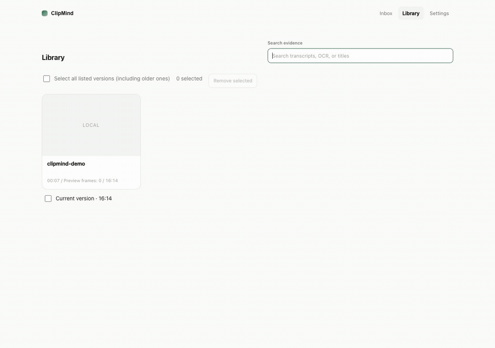

# ClipMind


[](https://github.com/yy31104/clipmind/actions/workflows/tests.yml?query=branch%3Amain)

A transcript misses the code, charts, and documents shown on screen.

ClipMind turns YouTube and Douyin links or local media into timestamped transcripts, screen text, and frames. It keeps the extracted evidence in a local folder that you can browse, search, or pass to another tool through the CLI, REST API, Python SDK, or MCP server.

Personal project. Built with AI assistance.

[Run locally](#run-locally) · [Docs](#docs)



The demo runs the same extraction pipeline as a local video, using a silent four-slide sample. [Still image](docs/images/demo.png).

## How it works

1. [sources/registry.py](clipmind/sources/registry.py) selects a source adapter; [acquisition.py](clipmind/acquisition.py) acquires media in a temporary directory.
2. [preflight.py](clipmind/preflight.py) estimates the work before [pipeline.py](clipmind/pipeline.py) starts speech and visual processing.
3. [asr.py](clipmind/asr.py), [ocr.py](clipmind/ocr.py), and [visual_states.py](clipmind/visual_states.py) extract timestamped speech, text, and visual changes.
4. [evidence.py](clipmind/evidence.py) writes the pack and its completion manifest; [index.py](clipmind/index.py) builds a searchable SQLite index.
5. [server.py](clipmind/server.py), [cli.py](clipmind/cli.py), [sdk.py](clipmind/sdk.py), and [mcp.py](clipmind/mcp.py) expose the saved evidence.

The full frame set is retained separately from the smaller reading preview. The completion manifest is written last; interrupted jobs remain visible after restart.

## Project layout

| Path | What | Start here |
| --- | --- | --- |
| `clipmind/` | Acquisition, extraction, storage, and interfaces | [pipeline.py](clipmind/pipeline.py) |
| `clipmind/web/` | Browser interface | [app.js](clipmind/web/app.js) |
| `schemas/` | Evidence Pack format | [JSON Schema](schemas/evidence-pack-v1.schema.json) |
| `tests/` | Offline lifecycle, API, and extraction checks | [test_pipeline.py](tests/test_pipeline.py) |
| `scripts/` | Installation, local samples, and measurement tools | [evaluate_silent_slides.py](scripts/evaluate_silent_slides.py) |
| `docs/` | Installation, usage, architecture, and privacy | [Usage](docs/USAGE.md) |

## Run locally

Requires Python 3.12, [uv](https://docs.astral.sh/uv/), FFmpeg, and Git. Linux also needs Tesseract; Node.js is used for the JavaScript syntax check. Platform setup is in [Installation](docs/INSTALL.md).

```bash
git clone https://github.com/yy31104/clipmind.git
cd clipmind
uv sync --frozen --python 3.12
uv run --frozen clipmind doctor
```

Extract the generated local sample and start the web interface:

```bash
uv run --frozen clipmind demo
uv run --frozen clipmind serve
```

Open [127.0.0.1:8420](http://127.0.0.1:8420), then choose Library to inspect the pack. Speech models are downloaded on first use; the silent demo needs no speech model.

Offline checks take about a minute locally:

```bash
make test
make eval-synthetic
```

The recorded synthetic results come from macOS Vision OCR. On Linux with Tesseract the same evaluation currently fails; see [the benchmark notes](docs/BENCHMARK.md#synthetic-silent-slides-on-linux-with-tesseract).

## Design notes

Speech and visual processing run separately, then join at pack creation. This preserves screen text that was never spoken and keeps a usable record when one recognition provider is unavailable.

The full frame set and the reading preview serve different purposes. Preview selection changes what a reader sees first while the original retained frames remain addressable by timestamp.

Evidence Pack files are the source of truth. The search index can be rebuilt, and the same saved pack is available through every interface. See the [format](docs/EVIDENCE_PACK.md) and [architecture](docs/ARCHITECTURE.md).

## Limits

- Source sites can reject downloads, change their responses, or remove media. Browser cookies are optional and grant access to the configured cookie store; see [privacy](docs/PRIVACY.md).
- OCR, speech recognition, and preview selection can miss information. The full frame set is uncapped, so long videos can require substantial time and disk space.
- The web server has no authentication and binds to loopback by default. Keep it local; share exported packs only after reviewing their contents.

## Docs

- [Installation and platform setup](docs/INSTALL.md)
- [CLI, SDK, REST, and MCP usage](docs/USAGE.md)
- [Architecture](docs/ARCHITECTURE.md)
- [Evidence Pack format](docs/EVIDENCE_PACK.md)
- [Privacy](docs/PRIVACY.md)
