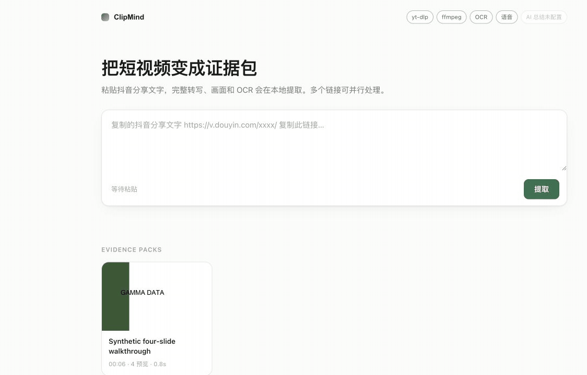

# ClipMind

**Turn videos into evidence that humans and AI agents can actually use.**

ClipMind is a local-first multimodal ingestion engine. Paste a verified YouTube
or Douyin URL, or drop a local video, audio file, or still image; it extracts
available speech, on-screen text, visual states, layout, scene/build/scroll
structure, and provenance into a
versioned Evidence Pack. The result is useful on its own and directly consumable
from a CLI, REST API, Python SDK, or MCP server.

No paid model API is required. ClipMind preserves extracted evidence instead of
substituting a generated summary. Packs record which modalities completed and
which were unavailable; a structurally complete pack does not imply perfect ASR
or OCR. Resource estimates can refuse a job before ASR/OCR, while acquisition
and decoder failures are reported explicitly.

Pasting a link removes the need to download a file manually. Local ASR and OCR
still need the media bytes, so ClipMind temporarily retrieves the requested
video before analysis. With the default source-retention setting, those
temporary media files are cleaned after processing or failure; transcripts,
OCR and retained evidence images remain in the Evidence Pack. During Douyin
transfers, the UI reports received bytes and a known total instead of showing
a misleading whole-job 0%. A long source can subsequently stop at preflight
and require an explicit **Process anyway** choice for that item.

```text
URL or local file
       │
       ▼
SourceAdapter → temporary MediaAsset ─┬→ local ASR + word timing ──┐
                                      └→ visual states + local OCR ┤
                                                                  ▼
                                              deterministic timeline fusion
                                                                  │
                                                                  ▼
                                                        Evidence Pack v1
                                          ┌───────────────┼───────────────┐
                                          ▼               ▼               ▼
                                      human UI       CLI / REST       MCP / agents
```



The demo uses a synthetic silent four-slide fixture. It contains no downloaded
video, third-party imagery, creator identity, or account information.

## Why ClipMind

Most video tools optimize for a transcript or a generated summary. ClipMind
preserves the source evidence first:

- `visual_states/all/` is the canonical, uncapped evidence set. A comparison
  failure keeps the frame and records a warning instead of silently dropping it.
- `visual_states/preview/` is a smaller derived view for humans. It can collapse
  progressive builds and choose stable representatives without changing the
  canonical set.
- burned-in captions and documents are distinguished using transcript overlap;
  unspoken slide, code, or UI text gets an explicit novelty measurement.
- `manifest.json` is written last. Partial work is never advertised as a
  reusable pack.
- compact reading exports select independently useful visual content and record
  every selection decision. The complete transcript, omitted OCR text and full
  original pack remain available for a human or agent to check those decisions.

## Verified inputs

| Input | Built-in adapter | Acquisition note |
| --- | --- | --- |
| YouTube / Shorts | `youtube` | yt-dlp; cookies are tried only as configured |
| Douyin videos and image posts | `douyin` | anonymous public feed with an exact item-ID check, then configured yt-dlp attempts and a temporary signed-out Chrome session ([details](docs/PRIVACY.md#douyin-public-feed)); image pages retain source order; account-gated media may still fail |
| MP4, MOV, MKV, WebM, AVI, audio, and other FFmpeg media | `local-file` | copied without modification; shared provenance omits the original directory |
| Local still images | `local-file` | original image bytes and local OCR; supported formats depend on the installed image decoder |
| Third-party packages | `clipmind.sources` entry point | see [Source adapters](docs/SOURCE_ADAPTERS.md) |

Only YouTube, Douyin, and local files are advertised as verified built-ins.
An adapter means ClipMind recognizes and normalizes a source; it is not a
promise that private, removed, region-locked, DRM-protected, or upstream-changed
media can be downloaded.

See [Input types and verification](docs/INPUT_TYPES.md) for silent video,
audio with cover art, animation, multipage TIFF, image posts, articles and
document-format boundaries. The browser and local-file paths accept common
camera/legacy media such as TS/M2TS, MPEG, WMV, WMA and AIFF; actual codec
decoding and the normal resource budgets still determine whether extraction succeeds.

Xiaohongshu shortlinks and note URLs also have an experimental, public-note
adapter for videos and ordered static-image posts. It verifies the exact note
and reports login requirements explicitly. Its public contracts are tested;
authenticated capture has not been verified. See the support matrix before
depending on a particular source.

For saved output integrity, use `clipmind verify PACK_ID --json`. Compact exports
include a per-image selection report and retain omitted OCR as text. See
[Reliable operation and release gates](docs/PRODUCTION.md) for crash recovery,
visual-quality checks, verification limits and release requirements.

Static images and acquired Douyin image pages retain their original bytes and
page order, including repeated pages. Videos without an audio track, or with no
detected speech, can complete with visual evidence and OCR. An image post whose
soundtrack was not acquired is explicitly marked `audio_status=not_acquired`;
this does not claim that the original post was silent. Website changes, access
restrictions, decoder support, and OCR quality can still prevent extraction.

Douyin Live Photo posts retain each original image and sample its associated
motion clip in page order. Dynamic states show a page number and clip-local
seconds; these are not a whole-post playback clock. Every declared motion clip
must download and decode successfully before the pack is published. Motion is
sampled at the configured frame rate; image-post soundtracks and motion audio
are not transcribed by this visual extraction path.

WeChat Channels `https://weixin.qq.com/sph/...` links have an **experimental**
local browser path. The public page exposes only a preview. On Windows, run
`./scripts/clipmind_windows.ps1 wechat-login`, sign in by scanning the QR code
on Tencent Yuanbao's official page, and close the browser window. Then submit
the share link. The dedicated Chrome profile stays under your local ClipMind
data directory. This route has not yet passed an authenticated end-to-end test;
some links may remain viewable only inside WeChat. ClipMind will report that
failure rather than create a partial Evidence Pack.

## Install

ClipMind is not published to PyPI and does not ship a signed public `.dmg`.
Use a source checkout and its committed lockfile. Python **3.12** is the
recommended interpreter for the locked setup. Changes under **Unreleased** in
[CHANGELOG.md](CHANGELOG.md) are not a new tagged release.

### Windows (PowerShell)

Follow the [Windows installation guide](docs/INSTALL.md#windows-powershell) first
to install Git, uv, FFmpeg, Tesseract with the languages you need, and optional
Chrome. In a new PowerShell window:

```powershell
git clone https://github.com/yy31104/clipmind.git
Set-Location clipmind
uv python install 3.12
uv sync --locked --python 3.12
# Follow the guide's CPU-first configuration before processing speech.
.\scripts\clipmind_windows.ps1 doctor
.\scripts\clipmind_windows.ps1 demo
.\scripts\clipmind_windows.ps1 serve
```

Open [http://127.0.0.1:8420](http://127.0.0.1:8420/). Keep that PowerShell process
running; press Ctrl+C when idle to stop it. Repeating `serve` detects an existing
ClipMind listener instead of starting a second queue. Do not run the Unix
`install.sh` on Windows.

### macOS / Linux

Install uv and FFmpeg first; Linux also needs Tesseract and its language data
([system setup](docs/INSTALL.md#recommended-source-install)). Then:

```bash
git clone https://github.com/yy31104/clipmind.git
cd clipmind

uv python install 3.12
uv sync --locked --python 3.12
uv run --locked clipmind doctor
uv run --locked clipmind demo
uv run --locked clipmind serve --host 127.0.0.1 --port 8420
```

Open [http://127.0.0.1:8420](http://127.0.0.1:8420/). Commands elsewhere in this
README use the installed `clipmind` command; inside a checkout, prefix them with
`uv run --locked` or use the Windows launcher where an action is available.

Windows and Linux use faster-whisper plus Tesseract by default. Apple Silicon
macOS uses MLX Whisper plus Vision. Model weights may be downloaded by the
selected local provider on first use.
The Windows guide includes an optional, tested CUDA 12/cuDNN 9 route for
faster-whisper and explains how to diagnose Chrome-cookie versus Douyin
browser-metadata failures. Successful capture of one real Douyin link is not a
guarantee that every account-gated or newly changed link will work.

### First run

```bash
clipmind doctor   # are ffmpeg, yt-dlp and the local providers available?
clipmind demo     # extract a generated sample: no network, no account
clipmind serve    # browse the result at 127.0.0.1:8420
```

`clipmind demo` renders a short **silent** slideshow locally and exercises real
sampling, OCR, pack writing and temporary-file cleanup. It does not test speech
transcription or website acquisition. Next, process a short local recording with
speech, then a source link you are allowed to access. Check the modality status
and run `clipmind verify PACK_ID --json` before relying on the result.

For existing installations, follow [update and rollback](docs/INSTALL.md#update-and-rollback)
instead of overwriting the library or an existing `.env`.

For setup details, platform dependencies, Docker, and the unsigned local macOS
build, see [Installation](docs/INSTALL.md).

### Docker

```bash
docker build -t clipmind .
docker run --rm -p 127.0.0.1:8420:8420 -v "$PWD/clipmind-data:/data" clipmind
```

The image uses faster-whisper and Tesseract. It does not bundle browser cookies,
GPU drivers, or model weights.

## Use it

### Web app

Paste one or more links, or drop local media. Inbox shows live jobs, Library
searches complete packs. Timed search hits open the evidence at that moment, with
the screenshot on screen, its OCR text and the nearby speech side by side;
clicking any screenshot shows the same context. The **画面** tab starts with a
compact preview and can reveal every retained canonical frame. Over-budget work is refused with an estimate; only an
explicit **Process anyway** starts the full untruncated job.

Image collections use page labels such as **第 1 张**, with OCR beside each
original image. They have no invented playback times or speech transcript.
Search also covers OCR retained as text in compact packs. When a screenshot
was omitted, its hit opens the full text and explicitly says no image is attached.

To tidy the list, expand unfinished tasks or open Library, select individual
entries (including old versions) or select all, then choose **删除所选** and confirm.
Only terminal jobs can be removed. Files move to the library's `.trash`, remain
recoverable and still occupy disk space; original media and exports are untouched.
See [recovery and privacy details](docs/PRIVACY.md#removing-tasks-and-library-versions).

If an older pack kept its screenshots but OCR was unavailable, repair it locally
without downloading or transcribing the source again:

```bash
uv run --locked python scripts/rebuild_preview.py --refresh-ocr out/PACK_ID
```

The command refuses to replace the pack when OCR still fails on every frame.
After a successful repair, restart a running ClipMind service so its in-memory
job snapshot reloads the repaired result.

### CLI

```bash
clipmind analyze "https://youtu.be/..."
clipmind analyze --force "/path/to/local-video.mp4"
clipmind list
clipmind search "retrieval augmented generation"
clipmind transcript PACK_ID
clipmind timeline PACK_ID --json
clipmind export PACK_ID --output evidence.zip
clipmind export PACK_ID --compact --output reading.zip
clipmind export PACK_ID --text-only --output text.zip
clipmind doctor
```

`--force` means “process the complete source despite the estimate.” It never
means truncate, lower resolution, or manufacture a partial pack.

### Python SDK

```python
from clipmind.sdk import ClipMind, PackLibrary

packs = ClipMind().analyze_sync("https://youtu.be/...")
pack = packs[0]
print(pack.id, pack.summary())

hits = PackLibrary().search("vector database")
frame_path, state = pack.frame(timestamp=143.0)
# For an image collection, use its original zero-based page index instead:
# frame_path, state = pack.frame(source_image_index=1)
```

### REST API

Start `clipmind serve`, then use the canonical read API:

```text
GET /api/packs
GET /api/packs/{pack_id}
GET /api/packs/{pack_id}/transcript
GET /api/packs/{pack_id}/timeline
GET /api/packs/{pack_id}/ocr
GET /api/packs/{pack_id}/search?q=...
GET /api/packs/{pack_id}/frame?timestamp=143
GET /api/packs/{pack_id}/frame?source_image_index=1
```

Image collections use `visual_state_id` or the zero-based `source_image_index`,
not playback timestamps. Search hits for omitted OCR have `visual_available=false`,
`ref=null` and `timestamp=null`; their source position does not imply an attached image.

Extraction and browser uploads use `POST /api/jobs` and `POST /api/uploads`.
The local server binds to loopback by default and has no authentication; do not
expose it to a LAN or the public internet.

### MCP for agents

```bash
clipmind-mcp
# or: clipmind mcp
```

The stdio server exposes:

```text
clipmind.extract_video
clipmind.get_transcript
clipmind.get_visual_timeline
clipmind.search_evidence
clipmind.get_frame
clipmind.export_pack
```

It also exposes complete evidence documents as read-only
`clipmind://packs/<pack-id>/evidence` resources. See [MCP integration](docs/MCP.md)
for configuration and tool contracts.

## Evidence Pack

Every successful job publishes `manifest.json` last. The current writer emits
`clipmind-evidence-pack@1.3.0`; readers accept every additive v1 minor from
`1.0.0` through `1.3.0`.

```text
<library>/<pack-id>/
├── manifest.json                 # completion marker, written last
├── source.json                   # normalized provenance
├── job.json                      # durable lifecycle and result view
├── preflight.json                # local estimate; outside the exported contract
├── transcript.jsonl              # segments, optional words/speakers
├── transcript.md
├── ocr.jsonl                     # text plus optional normalized layout boxes
├── visual_timeline.jsonl         # timing, scenes, builds, scrolls, novelty
├── evidence.md                   # deterministic chronological rendering
└── visual_states/
    ├── all/                      # canonical; no count cap
    └── preview/                  # compact derived view; no fixed budget
```

`metadata.json` and `transcript.json` are UI/migration artifacts outside the full
canonical ZIP; compact copies include them for portable reading. `note.md` and
`keyframes/` are read only for packs created before the Evidence Pack became
canonical; current jobs do not write them.

For videos with speech, the web UI's primary action is **compact download**:
full transcript and word timing, screenshots for independently useful code, documents, tables, charts or
instruction lists, and the recognized text of omitted images. Pure spoken
commentary can have **zero screenshots** when no independent visual content is
detected; the algorithm does not force cover/first/last/context frames.
Scene changes, hand gestures, caption changes, OCR noise and empty OCR alone
do not qualify an image. A **text-only download** explicitly omits every image.
Selected previews reference the same canonical image instead of being stored twice.
Image collections and visual-primary videos keep their canonical images in the
compact download; the explicit text-only profile still contains no image files.
Selection uses local layout and image structure heuristics; it is not a guarantee
that every important visual is found. Recognition failures are recorded and do
not force context screenshots into the compact copy.
**Full download** keeps every canonical image; SDK exports and Inbox handoff
from the original library pack keep the full evidence. Re-exporting a compact
copy preserves that copy's subset and cannot restore omitted images. Existing
packs are not deleted or rewritten when downloading a compact copy. CLI exports
remain full unless `--compact` or `--text-only` is supplied.

See [Evidence Pack v1](docs/EVIDENCE_PACK.md) and the machine-readable
[JSON Schema](schemas/evidence-pack-v1.schema.json).

## Local providers

| Capability | macOS Apple Silicon | Linux / Windows | Optional |
| --- | --- | --- | --- |
| ASR | MLX Whisper | faster-whisper | explicit provider/model selection |
| OCR | Apple Vision | Tesseract | normalized layout boxes where available |
| speaker diarization | off | off | local pyannote with extra + `HF_TOKEN` |

Provider failures are explicit modality states. ASR can be unavailable while
visual evidence still completes; per-frame OCR errors retain the image and mark
the record partial. Speaker labels are never invented when diarization is off.

## Extraction invariants

- canonical evidence is never capped, truncated, or silently dropped to meet a
  budget;
- preview derivation cannot remove or repoint canonical artifacts;
- a hash/comparison failure fails open and remains observable;
- `queued` persists before scheduling and `running` persists before acquisition;
- interrupted work is not replayed automatically;
- canonical evidence images are retained, temporary source media is cleaned,
  and `manifest.json` is
  the only completion marker;
- search uses a rebuildable SQLite index; Evidence Pack files remain the source
  of truth.

These contracts and their failure behavior are detailed in
[Architecture](docs/ARCHITECTURE.md).

## Measured quality

The repository includes case definitions and historical measurements for three
public Douyin sources, plus generated visual fixtures. The real media and
completed Evidence Packs are not distributed with the code. A fresh clone does
not have the inputs needed to pass the existing-pack audit. Historical results
are not a fresh acceptance run for the current commit or another platform.

For the deterministic screenshot-selection gate, run
`uv run --locked python scripts/evaluate_visual_quality.py --output visual-quality.json`.
It checks labeled information groups, redundant selections and unchanged inputs.
These fixtures are useful regression checks, not a guarantee of semantic
completeness on arbitrary videos.

## Evaluation

```bash
make test            # deterministic offline tests
make eval            # audit existing real-video packs; no re-extraction
make eval-reextract  # fresh real-source extraction; network/providers required
make eval-synthetic  # generated silent-slide end-to-end fixture
make bench
```

PowerShell equivalents are in the [contributor verification checklist](CONTRIBUTING.md#verification-checklist);
Windows developers do not need Make, jq, or a Unix shell for the native checks.

- `make test` runs deterministic lifecycle, failure-injection, schema, timeline,
  recovery, cache, concurrency, and visual-algorithm tests without network access.
- `make eval` audits completed real-video packs listed in `eval/cases.json`.
  It needs those matching packs in the selected library and reports missing
  inputs as failures. It is normally offline, but does not prove that the
  current pipeline can reproduce those packs.
- `make eval-reextract` runs the same cases through the current pipeline in a
  fresh temporary library without cache reuse. It requires usable local
  providers, network access, and possibly a current Chrome session; third-party
  source links may expire or disappear. Exact canonical counts are enforced only
  when the downloaded source SHA-256 matches the reviewed case baseline; source
  drift is reported separately and falls back to the broad quality bounds.
- `make bench` checks bounded batch scheduling with deterministic simulated work.

The following **historical v1 measurements** covered long code/UI and scrolling,
dense small text, talking-head captions, documents and progressive slides. They
are not current-v4 screenshot counts or evidence that this commit passed a
fresh real-source benchmark:

| Source type | Canonical | Old preview | v1 preview | End-to-end |
| --- | ---: | ---: | ---: | ---: |
| code/UI, 227 s | 243 | 205 | 69 | 41.15 s |
| talking head + documents, 64 s | 29 | 27 | 6 | 13.22 s |
| talking head + slides, 52 s | 31 | 23 | 4 | 8.17 s |

A same-source resolution experiment recognized 1,034 unique OCR characters at
1280 px versus 559 at 640 px; OCR time rose from 24.7 to 36.6 seconds. A 4 fps
probe found production 2 fps covered 105/105 states stable for at least 0.5 s.
See [Real-world evaluation](docs/REAL_WORLD_EVAL.md),
[Benchmarks](docs/BENCHMARK.md), and the checked-in raw JSON measurements.

`make eval-synthetic` generates a silent four-slide fixture and exercises real
FFmpeg, the selected local OCR provider, no-audio handling, preview and packaging.
The historical macOS run used Vision and retained all four labels and images;
other providers and machines need their own result checks.

## Privacy

Speech recognition, OCR, visual analysis, indexing, and pack generation run
locally. URL acquisition and first-use model downloads are network operations.
Browser-cookie access is optional but broad: when enabled, yt-dlp reads the
configured browser cookie store, not only one domain. Evidence Packs can contain
faces, voices, usernames, URLs, and personal information from the source.

Read [Privacy](docs/PRIVACY.md), [Limitations](docs/LIMITATIONS.md), and
[Security policy](SECURITY.md) before exposing or sharing output.

## Contributing

The easiest independent contribution is a source adapter: publish an object
implementing the small protocol under the `clipmind.sources` Python entry-point
group; no core `if/elif` chain is required. Extraction providers and Evidence
Pack readers also have stable boundaries.

Start with [CONTRIBUTING.md](CONTRIBUTING.md), the
[source-adapter guide](docs/SOURCE_ADAPTERS.md), and the
[roadmap](docs/ROADMAP.md). Release history is in the
[changelog](CHANGELOG.md). Please use the issue templates for reproducible bugs
and source requests. Security reports follow [SECURITY.md](SECURITY.md).

Licensed under the [MIT License](LICENSE).
