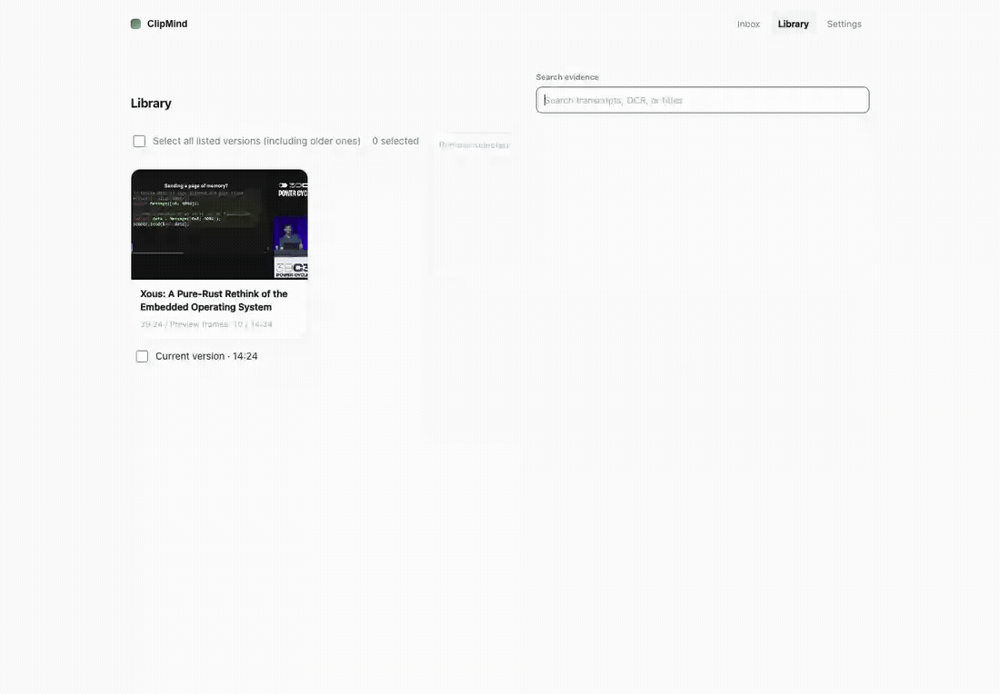

# Search a real talk, then ask an agent

This is an actual extraction and UI recording, not the generated silent fixture.
The source is **Xous: A Pure-Rust Rethink of the Embedded Operating System**,
by **bunnie and Sean “xobs” Cross**, 39C3, published by CCC under
[CC BY 4.0](http://creativecommons.org/licenses/by/4.0).
[Original recording](https://media.ccc.de/v/39c3-xous-a-pure-rust-rethink-of-the-embedded-operating-system).
The recording and screenshots retain the speakers' and conference attribution.
ClipMind UI overlays and the excerpts below are adaptations.

## Search → timestamp → slide



[WebM recording](images/real-talk-search.webm) ·
[Readable still](images/real-talk-search.png) ·
[Actual browser verification](data/real-talk-ui-demo.json)

The search phrase **“a string that is moved”** finds speech at **12:01.76**.
Clicking that hit opens the retained slide beginning at **11:54**, alongside
its recognized text and nearby speech. “View in transcript” returns to the
spoken passage. These are distinct clocks: a slide can start before the
sentence that refers to it. OCR visibly omits some code; the screenshot remains
available for inspection.

The full 2,364-second source was acquired and processed on an M4 Pro / 24 GB,
using English MLX Whisper large-v3-turbo and Apple Vision. The run produced
749 speech segments, 387 canonical visual states and 10 previews in 368 seconds,
including acquisition. No acquisition media remained. These are this run's
measurements, not a performance promise. Speaker diarization was unavailable.
[Manifest and timings](data/real-talk-demo.json).

Reproduce with a development checkout, system dependencies and local models:

```bash
PYTHON_DOTENV_DISABLED=1 uv run --frozen python scripts/demo_real_talk.py --workdir /tmp/clipmind-real-demo --full-talk
CLIPMIND_OUT=/tmp/clipmind-real-demo/packs uv run --frozen clipmind serve
```

The explicit full-talk flag authorizes this complete local workload; it does
not disable transport controls. First use downloads model weights. The output
directory must be outside the checkout. For English sources set
`CLIPMIND_ASR_LANGUAGE=en`; the normal default remains Chinese.
To record the UI using a separate temporary Chrome context:

```bash
uv run --frozen python scripts/record_real_demo.py --url http://127.0.0.1:8420 --output /tmp/clipmind-ui-demo
```

## A real agent used the MCP tools

Question: **How does Xous transfer memory between processes while preserving
Rust ownership?**

Codex CLI, authenticated with an existing ChatGPT subscription, made **11 actual
MCP tool calls**: lexical searches, bounded visual-timeline reads, and two frame
reads. No browser search, new extraction, shell access or API-key billing was
used to answer. The client allowlisted only `search_evidence`,
`get_visual_timeline` and `get_frame`; those reads were explicitly approved in
its temporary configuration. It first tried a query with no results, refined
the query, and then inspected the saved evidence.

[Captured calls and final answer](data/real-talk-mcp-demo.json) contains the real
arguments, status and result excerpts. Large images are represented by their
byte lengths and SHA256 digests; excerpts are shortened, not invented tool
responses. The final answer was:

> Xous transfers memory by detaching a page from the sender's address space
> and attaching it to the receiver's, with the MMU enforcing ownership.

It cited the speech at **12:52.96–13:10.18** and **16:54.26–17:03.52**, and the
ownership and lending slides at **11:54** and **13:04.50**. Those citations can
be checked against the original recording and the exported frames; a fluent
agent answer alone is not evidence of accuracy.

Use [the MCP client configuration](MCP.md) with `CLIPMIND_OUT` pointing to the
same library. The local MCP server needs no model account or API key. An agent
client is separate and follows its own subscription/provider terms. Read-only
library use needs no browser cookies or network media acquisition.
